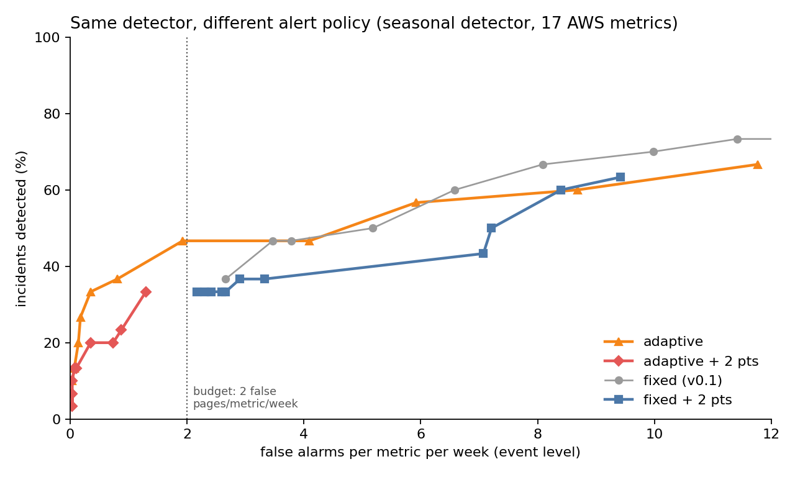

# Capacity Forecast

[](https://github.com/fakhri-hamza/capacity-forecast/actions/workflows/ci.yml)  [](LICENSE)

**Detecting incidents and forecasting load on real cloud servers: what works, and at what cost in false alarms?**

Data: the AWS CloudWatch part of the [Numenta Anomaly Benchmark](https://github.com/numenta/NAB): 17 real production metrics (EC2 CPU, disk writes, network in, load-balancer requests, RDS CPU), one point every 5 minutes, ~2 weeks each, **30 expert-labelled incident windows**.

## 1. Incident detection: the alert-fatigue trade-off


Three label-free detectors, one shared rule: **alarm when a score is higher than anything seen in the first 15% of the series** (the learning period). Nothing is tuned on labels. Evaluated the way an on-call engineer would judge it:

| Detector (default threshold) | Incidents detected | False alarms per metric per week |
|---|---|---|
| Seasonal: compare with the same time yesterday | **70%** (21/30) | 10.0 |
| Rolling z-score over the past day | 53% (16/30) | 4.0 |
| Isolation Forest on local features | 50% (15/30) | **3.3** |

- **There is no free lunch.** Catching 70% of incidents costs ~10 useless pages per metric per week; across 50 monitored metrics that is ~70 false pages a day. Halving false alarms drops detection to ~50%.
- **The simple rolling z-score is the most efficient at low alert budgets** (40% of incidents for 1.4 false alarms/week). Isolation Forest only catches up when you accept many more alerts.
- Isolation Forest scores are bounded, so a threshold above the learning-period maximum never fires (the vertical drop in the curve). A real limitation when you calibrate it this way.


*Example: an EC2 instance's CPU falls from ~93% to ~25% on 16 Apr (labelled incident). All three detectors fire inside the window; the z-score also pages on smaller dips elsewhere.*

### 1b. Same detector, smarter alert policy
The detector scores how unusual each point is; the **alert policy** decides when that becomes a page. Holding the best detector (seasonal) fixed, I compared four label-free policies (`python -m capfc.policies`):
- **fixed:** the v0.1 rule, with a threshold frozen after the learning period;
- **adaptive:** the score must beat the 99.9th percentile of the *previous 7 days*, so the threshold drifts with the metric;
- **+ 2 pts:** each of the above with a persistence filter: the condition must hold for 2 consecutive points (10 min).



| Alert budget (false pages per metric per week) | fixed (v0.1) | fixed + 2 pts | adaptive | adaptive + 2 pts |
|---|---|---|---|---|
| ≤ 1 | unreachable | unreachable | **37%** (0.8/wk) | 23% |
| ≤ 2 | unreachable | unreachable | **47%** (1.9/wk) | 33% |
| ≤ 4 | 47% (3.8/wk) | 37% | 47% (1.9/wk) | 33% |

- **When you can only afford a few pages, the adaptive threshold wins clearly.** It catches 47% of incidents with 1.9 false alarms per week; the fixed rule needs 3.8 for the same 47% and never gets below 2.7 at any setting I tried (2.2 with the persistence filter). A frozen threshold keeps paging when a metric's normal level drifts; a rolling one gets used to it.
- **When you want high recall, the fixed rule is better** (60% at 6.6/wk vs 8.7/wk for adaptive). The adaptive threshold also gets used to incidents that last long enough. No policy wins everywhere.
- **Persistence filters hurt here.** Many labelled NAB incidents are short, so requiring 10 minutes of confirmation loses more incidents than false alarms. It's a common default in alerting tools, but on this data it is worse than nothing.
- Caveat: 30 incident windows means each one is 3.3 points of detection rate. Treat small differences as noise.

## 2. Day-ahead capacity forecasting: the flat line wins


Forecast the last day (288 points) from everything before it. MASE = error relative to "same as yesterday" on the training data (below 1 = better).

| Model | Median MASE | Series won (of 17) |
|---|---|---|
| **Naive: tomorrow = last value, flat** | **0.63** | **10** |
| Seasonal naive: tomorrow = today | 0.70 | 4 |
| Holt-Winters (daily seasonality) | 0.84 | 2 |
| Gradient boosting (lags 1–2 days, time of day) | 0.93 | 1 |

These production metrics have **weak daily seasonality**: they are dominated by level shifts and noise, so models that assume "every day looks the same" add error. For capacity planning on such metrics, the right first question is not "which model?" but "is there any structure to forecast?". Check this before deploying Prophet or an LSTM. (During my 2026 internship I used Prophet and LSTM for capacity planning on Linux system logs; this project tests the same question on public data.)

## Reproduce
```bash
python -m venv .venv && .venv\Scripts\activate
pip install -r requirements.txt && pip install -e .
python -m capfc.run      # downloads 17 series (~2 MB), prints both studies
python -m capfc.plots
python -m capfc.policies  # alert-policy comparison (1b)
pytest
```

## Layout
```
src/capfc/data.py      download NAB AWS series + labelled windows, regular 5-min grid
src/capfc/detect.py    3 detectors, label-free threshold, event-level evaluation
src/capfc/forecast.py  4 day-ahead models, MASE
src/capfc/run.py       runs everything, writes results/*.csv
src/capfc/policies.py  fixed vs adaptive threshold, persistence filter, alert budgets
tests/                 detection, probation period, alarm grouping, MASE, alert policies
```

## Author
Hamza Fakhri, Computer Science engineering student, Polytech Nantes.

## License
MIT, see [LICENSE](LICENSE). The public datasets used here keep their own licenses (sources linked above).
